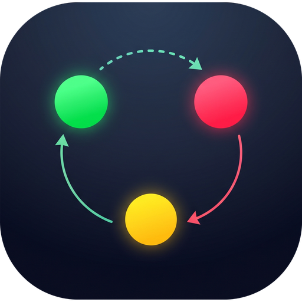

# Orquestra

Aplicativo desktop com uma tela infinita onde cada terminal é um bloco que você arrasta, redimensiona e liga a outros por setas. Feito para acompanhar vários agentes de código (Claude Code, Codex etc.) ao mesmo tempo, organizados em sessões.

## Instalar

- **Ubuntu:** `sudo apt install ./orquestra_0.1.1_amd64.deb`. O Orquestra aparece no menu de aplicativos e pode ser fixado na dock. Para desinstalar: `sudo apt remove orquestra`.
- **Windows:** rode o `Orquestra Setup 0.1.1.exe`. Para desinstalar, use as configurações.

Precisa ter Git, VS Code (comando `code`) e os agentes que você quiser usar (`claude`, `codex`). Ao desinstalar, as sessões salvas são apagada,os projetos, worktrees e branches não são tocados.

## Uso rápido

- **Terminal** (`N`): escolha a pasta, onde abrir e o agente.
- **Nova conexão** (`C`): escolha o tipo e clique no terminal de origem e depois no de destino.
- **Anotação** (`A`): escolha tamanho e cor e clique no quadro onde quer escrever.

Fechar a janela não para os agentes, para encerrar, use **Sair**.

## Documentação

- [Guia de uso](docs/uso.md): sessões, terminais, worktrees, setas, anotações, status e o comando `orquestra-abrir`.
- [Desenvolvimento](docs/desenvolvimento.md): rodar, testar, gerar instaladores e estrutura do código.
- [Spec: terminais de agentes e maestro](docs/specs/terminais-de-agentes-e-maestro.md)
